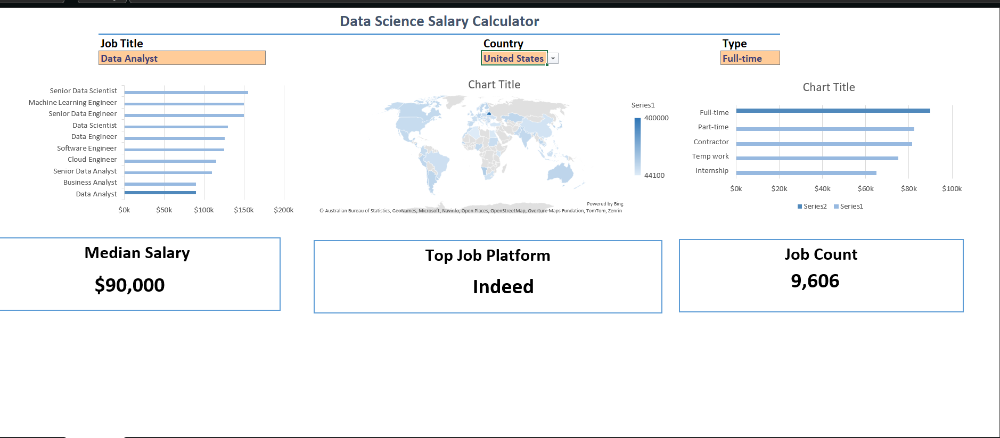
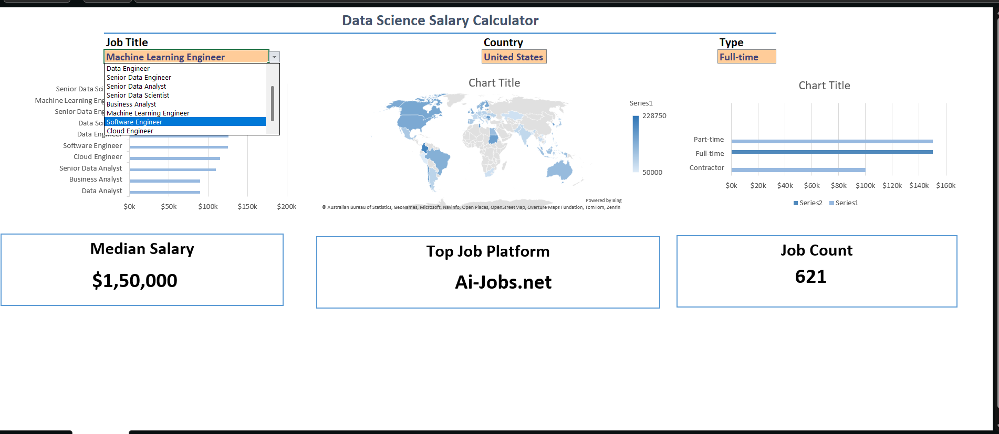

# Data Jobs Analysis (Excel Project)

## 📌 Project Overview
This project explores trends in the data job market using **basic Excel functions**.  
The goal was to identify demand patterns, required skills, and regional hiring insights — all without advanced tools like Power BI or Pivot Tables.

## 🎯 Objectives
- Analyze job postings related to data roles
- Identify most in-demand skills (Excel, SQL, Python, Power BI)
- Explore regional hiring trends and salary ranges
- Practice data cleaning, visualization, and storytelling in Excel

## 🛠️ Tools & Techniques
- **Excel Functions**: IF, VLOOKUP, TRIM, CONCATENATE, COUNTIF
- **Data Cleaning**: Removing duplicates, handling missing values
- **Charts**: Bar charts, line charts, pie charts for visualization
- **Tables**: Simple summary tables for insights

## 📊 Key Insights
- 📈 Growing demand for Data Analysts across industries  
- 🛠️ SQL, Python, and Excel remain core skills  
- 🌍 Regional differences in hiring and salary ranges  

## 📷 Dashboard Preview

[watch the dashboard demo](JobAnalysis1.mp4)

## 🚀 Learning Outcomes
- Strengthened Excel fundamentals for analysis
- Improved ability to tell a story with data
- Demonstrated that impactful insights can be created with basic tools

## 📂 Files Included
- `Data Jobs Analysis.xlsx` → Raw data + cleaned dataset + charts
- `Summary.pdf` → Executive summary of findings (optional)

## 🔗 How to Use
1. Download the Excel file.
2. Open in Microsoft Excel.
3. Explore the charts and tables to view insights.

## ✨ Next Steps
- Extend analysis with Pivot Tables or Power Query
- Build interactive dashboards in Power BI
- Compare job trends across multiple years

## Conclusion

I created this dashboard to showcase insights into salary trends across various data-related job titles. Utilizing data from my Excel course, this dashboard allows users to make informed decisions about their career paths. Exploring the functionalities to understand how location and job type influence salaries. 
---
